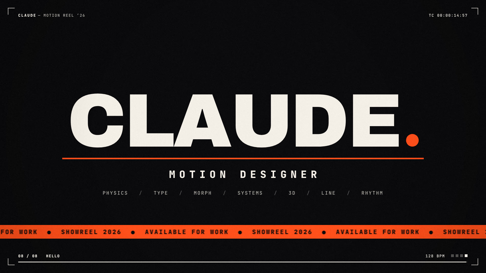

# Motion Reel ’26

A 15-second, 128 BPM motion-graphics showreel. It's drawn entirely in code,
rendered at 1080p60 with real sub-frame motion blur, and scored with a
soundtrack synthesized from scratch.

**▶ [`media/showreel.mp4`](media/showreel.mp4)** · live, in-browser version: [`reel/`](reel/index.html) · landing page: [`index.html`](index.html)



## Jaret's First Day: walkable campus version (`uconn/`)

**▶ [`uconn/`](uconn/index.html)** is a browser game simulating Jaret's first day as a UConn freshman
in Storrs. Jaret has short blonde hair, green eyes and a navy HUSKIES shirt. Walk the
campus from South Campus to Horsebarn Hill, make it to Intro to Psychology and Calculus I, and
play eight mini-games: Tray Dash, Pop Quiz, Math Sprint, Swag Grab, Free Throws, Scoop Stack,
Memory Match and a selfie with Jonathan the Husky. The day ends with a graded report card.

```
uconn/index.html       page, HUD and styles
uconn/js/engine.js     helpers, synthesized audio, input routing, dialogue and cards
uconn/js/art.js        all character, animal and item art (canvas vectors)
uconn/js/world.js      campus map, collision and A* pathfinding
uconn/js/worldDraw.js  campus rendering, day/night lighting, minimap
uconn/js/minis*.js     the eight mini-games
uconn/js/story.js      schedule, stats, clock and HUD
uconn/js/scenes.js     places, people and cutscenes
uconn/js/main.js       title screen, main loop and boot
```

Open `uconn/index.html` in a browser. It needs no build step. Controls: tap or click to walk (or WASD / arrows),
tap a building or person (or press E) to go in or talk, and press M for the map.

## The piece

Eight scenes of one bar each. Every scene ends as the next one begins, with no hard resets:

| # | Time | Scene | What happens |
|---|------|-------|--------------|
| 01 | 0:00.00 | **Physics** | A ball falls under real gravity with restitution 0.5, so each bounce halves onto the beat grid (1, 1.5, 1.75, 1.875 …). Squash and stretch, a live graph-editor readout, then it crouches and launches into… |
| 02 | 0:01.88 | **Type** | …the letter **I**, which falls over like a domino. Then MAKE (mask reveal, then a live variable-font weight sweep from 900 to 160), THINGS (sprung scatter-assembly plus extrude) and MOVE (bouncing letters). The camera zooms through the counter of the O into… |
| 03 | 0:03.75 | **Morph** | …an orange circle. A single 360-point path is sprung through square, triangle and star. The spring overshoot makes the shapes bulge. Time-echo trails, orbiting satellites and sonar pulses. It shrinks into a 120 px tile… |
| 04 | 0:05.63 | **Systems** | …the seed of a 17×9 Truchet field: spawn ripple, trim-path draw-on, three rotation waves and a diagonal card-flip wave. Then every tile collapses to a dot… |
| 05 | 0:07.50 | **3D** | …and the dots turn out to be a plane in perspective. It tilts into a rippling floor, wraps into a sphere, knots into a torus and turns to face the camera, so its rings become… |
| 06 | 0:09.38 | **Line** | …seven stroked paths with animated trim: spinning arcs, a 3:2 Lissajous knot, a travelling waveform, and finally flat stripes… |
| 07 | 0:11.25 | **Rhythm** | …which start a seven-cut montage, one cut every half beat, each entering through a different mask (iris, diagonal, blinds, clock, squares, doors). A wall of every scene so far implodes into a single dot… |
| 08 | 0:13.13 | **Hello** | …which explodes into the title. The dot arcs over and lands as the full stop. |

## How it's made

```
reel/index.html        page shell + fonts (open it to play live, with sound)
reel/showreel.js       the engine: every frame is a pure function of time
tools/render.js        headless-Chromium frame renderer → ffmpeg
tools/soundtrack.py    numpy/scipy synthesizer for the score
media/                 rendered output (mp4, poster, soundtrack)
```

- **Engine.** One Canvas 2D context, no libraries. Time runs in beats, so the
  picture and the music share a single clock.
- **Motion blur.** Each output frame averages 8 sub-frames across a 180° shutter,
  so the blur comes from the real motion. Hard cuts follow the frame's own
  time, so sub-samples never blend across a cut.
- **Score.** Kick, clap, hats, sidechained bass and supersaw pads, FM plucks,
  risers, whooshes and every UI tick are synthesized. Bounces, letter landings,
  tile clicks and montage cuts are placed on the same beat timeline as the
  picture.

### Re-render

Requires Node with Playwright (Chromium), Python 3 with numpy and scipy, and ffmpeg.

```sh
python3 tools/soundtrack.py                    # → media/soundtrack.wav / .m4a
node tools/render.js video                     # → media/showreel.mp4 (≈4 min on 4 cores)
node tools/render.js stills --beats 9.5,18.4   # spot-check single frames
```

Fonts: [Archivo](https://github.com/Omnibus-Type/Archivo) and
[JetBrains Mono](https://github.com/JetBrains/JetBrainsMono), both SIL OFL 1.1 (licences in `reel/fonts/`).

## Jaret's First Day at UConn

**▶ [`first-day/index.html`](first-day/index.html)**: a browser game that simulates
Jaret's first day at UConn's Storrs campus. It's one self-contained HTML file with
no build step. Open it in a browser and play with the mouse, keyboard or touch.

- **The day.** Walk the campus map from 8:00 AM to sunset. The clock only moves
  when Jaret does. Get the Husky One Card at the Student Union, make Intro to
  Psych (Laurel Hall, 10:00) and Calculus I (Oak Hall, 2:00), eat at McMahon,
  and reach Horsebarn Hill for the sunset.
- **Mini-games.** ID photo timing, Note Catch, the Calc warm-up blitz, Build Your
  Tray, free throws in Gampel Pavilion and Scoop Stack at the Dairy Bar. There's
  also the Involvement Fair, Babbidge Library, Spirit Rock and Jonathan the Husky.
- **Stakes.** Energy, Social, Brains and Spirit meters, six friends to make, 14
  badges, and Mirror Lake geese that chase you. The day ends with a report card,
  and progress saves in the browser.

A fan-made game, not affiliated with the University of Connecticut.
